# Lecture 8: Multi-channel Source Separation I

Source PDF: `speech-audio-lecture-08-1.pdf`

> **핵심:** 여러 microphone은 같은 소리를 서로 다른 시간 지연과 위상으로 관측한다. Delay-and-sum(DAS) beamformer는 목표 방향에서 생긴 지연을 되돌린 뒤 평균하여 그 방향의 성분은 같은 위상으로 더하고, 다른 방향의 성분은 덜 일치하게 만든다. 이 원리는 steering vector와 복소 가중치로 표현할 수 있지만, far-field plane wave·알려진 array geometry·충분히 작은 microphone 간격 같은 조건이 필요하다.

## 전체 흐름

| 순서 | 원문 범위 | 핵심 질문 |
|---|---|---|
| 1 | pp. 2–3 | Single-channel과 multi-channel 분리는 무엇이 다른가? |
| 2 | pp. 4–8 | ULA에서 microphone별 시간 지연은 어떻게 생기는가? |
| 3 | pp. 9–13 | 단순 합과 시간 filter는 왜 다른가? |
| 4 | pp. 14–19 | Dirac delta와 LTI convolution은 지연을 어떻게 표현하는가? |
| 5 | pp. 20–24 | DAS와 steering vector는 왜 같은 위상 정렬을 나타내는가? |
| 6 | pp. 25–27 | STFT 기반 Encoder–Separation–Decoder는 무엇을 계산하는가? |
| 7 | pp. 28–29 | 주파수와 microphone 간격이 beam pattern을 어떻게 바꾸는가? |

## 1. Multi-channel source separation의 출발점

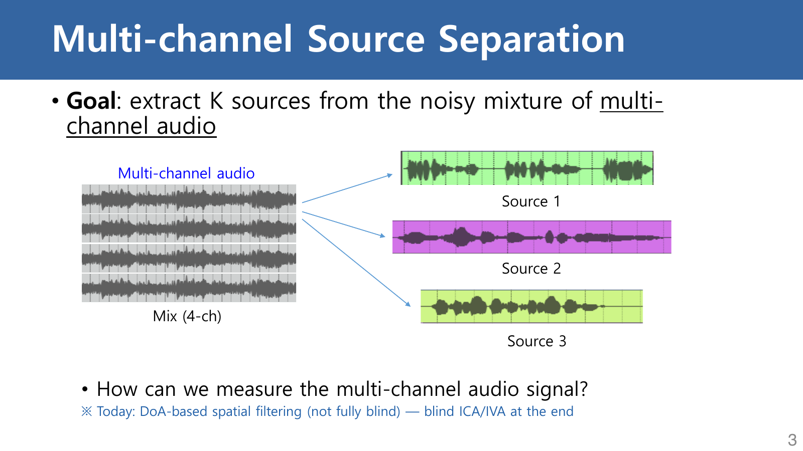

<a href="{{ "/assets/pdfs/study/speech-and-audio-recognition/speech-audio-lecture-08-1.pdf#page=3" | relative_url }}" target="_blank" rel="noopener">원문 PDF p. 3</a>은 네 개 microphone의 관측을 함께 사용해 세 source를 분리하는 문제를 보여준다. Single-channel 분리는 한 파형 안의 시간·주파수 패턴만 이용한다. Multi-channel 분리는 여기에 **공간 단서**를 더한다.

| 단서 | microphone 사이에서 보이는 차이 | 활용 방법 |
|---|---|---|
| 도달 시간차(TDOA) | 같은 파형이 조금씩 늦게 도착한다. | 목표 방향의 지연을 상쇄한다. |
| 위상차 | 주파수별 복소 계수의 각도가 달라진다. | Steering vector와 복소 가중치를 만든다. |
| 크기차 | 거리·차폐·지향성에 따라 진폭이 달라질 수 있다. | 더 일반적인 spatial filter나 통계 모델에서 사용한다. |

이번 강의의 핵심은 **방향을 알고 있다는 가정 아래 사용하는 DAS spatial filtering**이다. 따라서 완전히 blind한 ICA·IVA 전체를 다루는 강의로 확대하면 안 된다.

## 2. ULA에서 시간 지연이 생기는 이유

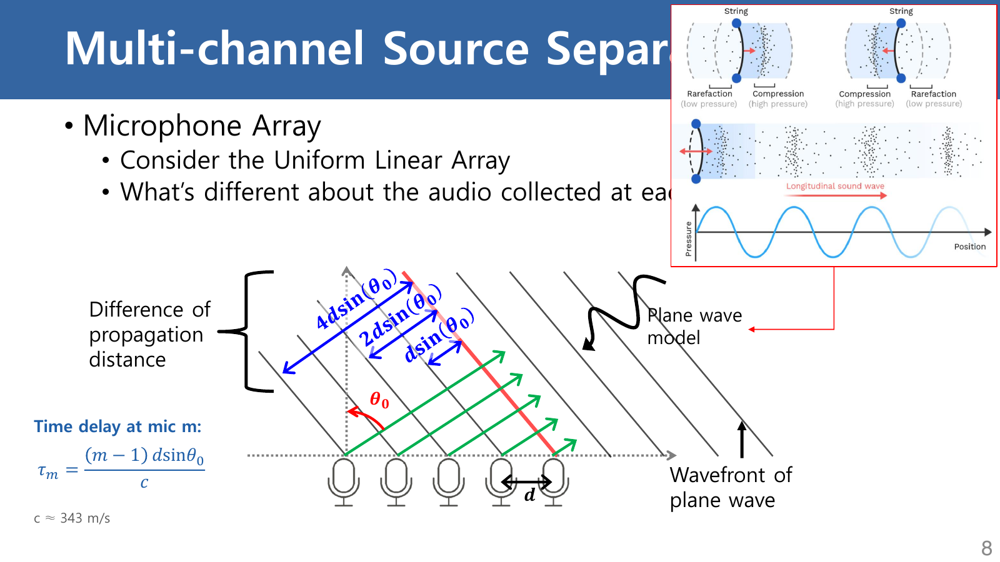

<a href="{{ "/assets/pdfs/study/speech-and-audio-recognition/speech-audio-lecture-08-1.pdf#page=8" | relative_url }}" target="_blank" rel="noopener">원문 PDF p. 8</a>은 microphone을 간격 $$d$$로 일렬 배치한 **uniform linear array(ULA)**를 가정한다. Source가 array에서 충분히 멀면 각 microphone 근처의 파면을 거의 평면으로 볼 수 있다. 이 far-field plane-wave 근사에서 인접 microphone의 경로 차이는 $$d\sin\theta$$다.

첫 microphone을 기준으로 잡으면 $$m$$번째 microphone까지의 상대 지연은

$$
\tau_m(\theta)=\frac{(m-1)d\sin\theta}{c}
$$

이다. 여기서 $$m$$은 1부터 시작하는 microphone index, $$d$$는 간격(m), $$\theta$$는 원문의 broadside 기준 입사각, $$c$$는 음속(m/s)이다. $$\tau_m$$의 단위는 초(s)다. Microphone 번호와 각도 양의 방향을 반대로 정하면 부호는 바뀌지만, **경로 차이를 음속으로 나눈다**는 관계는 같다.

### 2.1 작은 수치 예제

$$M=4$$, $$d=0.04\,\mathrm{m}$$, $$\theta=30^\circ$$, $$c=343\,\mathrm{m/s}$$라 하자. 인접 microphone의 지연은

$$
\Delta\tau=\frac{0.04\sin30^\circ}{343}\approx58.3\,\mu\mathrm{s}
$$

다. 네 microphone의 상대 지연은 약 $$[0,58.3,116.6,174.9]\,\mu\mathrm{s}$$가 된다. Sampling rate가 16 kHz이면 sample 단위 지연은 약 $$[0,0.93,1.87,2.80]$$이다. 대부분 정수가 아니므로 실제 beamformer에는 fractional-delay filter나 주파수영역 phase rotation이 필요하다.

Derivation: Path difference of a far-field plane wave

ULA의 축 방향 단위벡터를 $$\mathbf{u}$$, broadside에서 $$\theta$$만큼 기울어진 전파 방향의 단위벡터를 $$\mathbf{q}$$라 하자. 첫 microphone과 $$m$$번째 microphone의 위치 차이는

$$
\Delta\mathbf{r}_m=(m-1)d\mathbf{u}
$$

다. Plane wave의 등위상면에 수직인 방향으로 이 위치 차이를 투영하면 상대 경로 길이가 된다.

$$
\Delta \ell_m=\Delta\mathbf{r}_m^{\mathsf T}\mathbf{q}=(m-1)d\sin\theta
$$

전파 속도가 $$c$$이므로 거리 = 속도 × 시간에서

$$
\tau_m=\frac{\Delta\ell_m}{c}
=\frac{(m-1)d\sin\theta}{c}
$$

를 얻는다. 이 유도는 파면 곡률을 무시하는 far-field 근사와 microphone 위치가 정확하다는 가정을 사용한다. Source가 array에 가까우면 microphone마다 거리와 감쇠를 직접 계산하는 spherical-wave model이 필요하다.

## 3. Scalar weighted sum과 filter의 차이

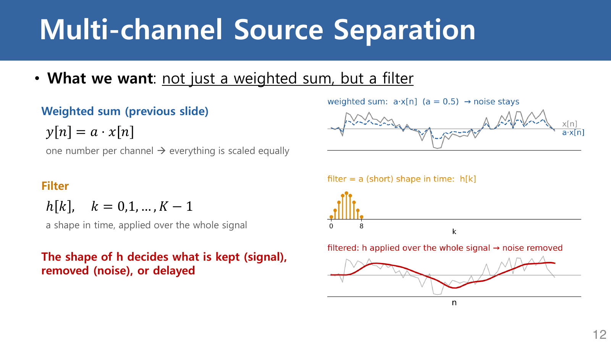

<a href="{{ "/assets/pdfs/study/speech-and-audio-recognition/speech-audio-lecture-08-1.pdf#page=12" | relative_url }}" target="_blank" rel="noopener">원문 PDF p. 12</a>의 왼쪽은 $$y[n]=a x[n]$$, 오른쪽은 여러 계수 $$h[k]$$를 사용한 filter다.

- **Scalar weight $$a$$:** 모든 시간 sample과 모든 주파수 성분을 같은 비율로 키우거나 줄인다.
- **Filter $$h[k]$$:** 현재와 과거 sample을 서로 다른 계수로 결합한다. 주파수별 gain과 phase를 다르게 만들 수 있다.

길이 $$K$$인 causal FIR filter는

$$
y[n]=\sum_{k=0}^{K-1}h[k]x[n-k]
$$

로 쓴다. 예를 들어 $$h=[0,1]$$이면 $$y[n]=x[n-1]$$이므로 한 sample 지연이다. 반대로 $$h=[1/2,1/2]$$이면 현재와 직전 sample의 평균이 되어 빠른 변화를 줄인다. Beamforming에서 filter가 필요한 이유는 channel마다 생긴 **시간 지연을 맞춰야 하기 때문**이다.

## 4. Dirac delta와 convolution

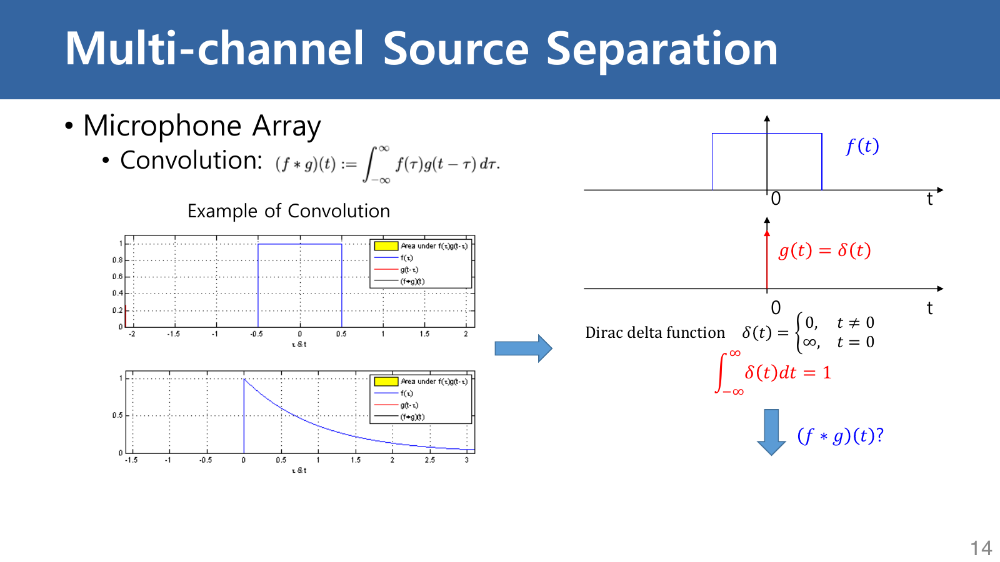

<a href="{{ "/assets/pdfs/study/speech-and-audio-recognition/speech-audio-lecture-08-1.pdf#page=14" | relative_url }}" target="_blank" rel="noopener">원문 PDF p. 14</a>은 $$\delta(t)$$를 0에서 무한대인 함수처럼 그린다. 이는 면적 1의 극도로 좁은 pulse를 떠올리게 하는 **직관적 표기**일 뿐 엄밀한 정의가 아니다. Dirac delta는 보통 함수가 아니라 다음 sifting 성질로 정의되는 distribution이다.

$$
\int_{-\infty}^{\infty}f(\tau)\delta(\tau-t_0)\,d\tau=f(t_0)
$$

따라서 convolution에서

$$
(f*\delta)(t)=f(t),\qquad
\bigl(f*\delta(\cdot-t_0)\bigr)(t)=f(t-t_0)
$$

가 된다. 이 sifting 식은 적절한 test function 또는 연속성이 충분한 $$f$$에 대해 해석한다. $$\delta(t-t_0)$$는 $$t_0$$만큼 지연시키고, $$\delta(t+t_0)$$는 수학적으로 $$t_0$$만큼 앞당긴다.

### 4.1 LTI system의 출력이 convolution인 이유

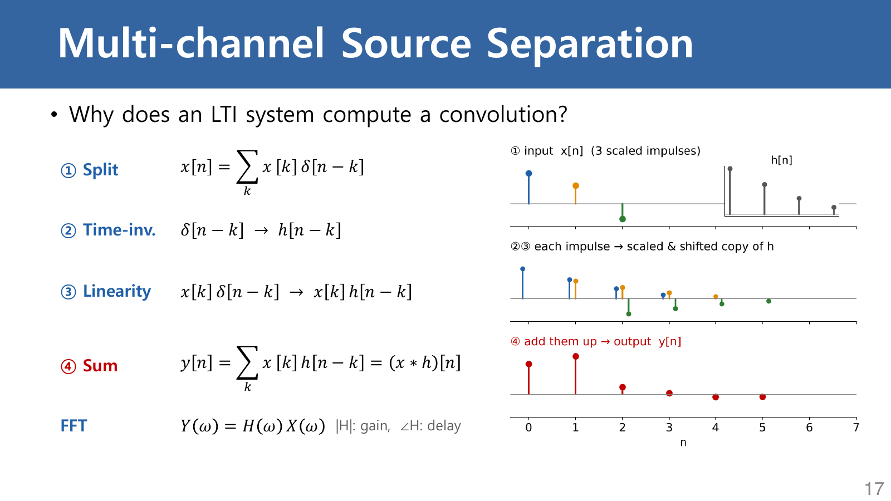

<a href="{{ "/assets/pdfs/study/speech-and-audio-recognition/speech-audio-lecture-08-1.pdf#page=17" | relative_url }}" target="_blank" rel="noopener">원문 PDF p. 17</a>의 읽는 순서는 분해, time invariance, linearity, 합산이다.

1. 모든 이산 신호를 shifted impulse의 가중합으로 쓴다.
2. $$\delta[n]$$에 대한 system 출력 $$h[n]$$을 impulse response라 한다.
3. Time invariance 때문에 $$\delta[n-k]$$의 출력은 $$h[n-k]$$다.
4. Linearity 때문에 각 출력을 $$x[k]$$만큼 곱해 모두 더할 수 있다.

결과는

$$
y[n]=\sum_k x[k]h[n-k]=(x*h)[n]
$$

이다. Fourier domain에서는 전체 convolution이 $$Y(\omega)=H(\omega)X(\omega)$$라는 곱으로 바뀐다. 다만 원문 p. 17의 `∠H: delay`는 조건을 생략한 축약이다. $$\angle H(\omega)$$는 **phase response**이고, pure delay일 때만 $$-\omega t_0$$ 형태의 linear phase가 된다. 일반 filter의 group delay는 $$-d\angle H/d\omega$$로 구한다.

Derivation: LTI convolution from the impulse decomposition

Kronecker delta는 $$\delta[0]=1$$이고 그 밖에서 0이다. 먼저 유한 구간 밖에서 0인 이산 신호는

$$
x[n]=\sum_k x[k]\delta[n-k]
$$

로 정확히 분해된다. LTI system을 $$T\{\cdot\}$$라 하고 $$h[n]=T\{\delta[n]\}$$라 정의한다. Time invariance로

$$
T\{\delta[n-k]\}=h[n-k]
$$

이며, linearity를 적용하면

$$
\begin{aligned}
y[n]
&=T\left\{\sum_k x[k]\delta[n-k]\right\}\\
&=\sum_k x[k]T\{\delta[n-k]\}\\
&=\sum_k x[k]h[n-k]
\end{aligned}
$$

를 얻는다. 무한 길이 신호로 확장할 때는 이 합과 system 연산의 순서를 바꿀 수 있는 통상적인 수렴성·안정성 조건이 추가로 필요하다. 이 결론은 그 조건 아래 system이 linear하고 time-invariant일 때 정확하다. Room impulse response가 움직임이나 환경 변화로 시간에 따라 바뀌면 짧은 구간에서만 LTI 근사가 성립한다.

## 5. Delay-and-sum beamforming

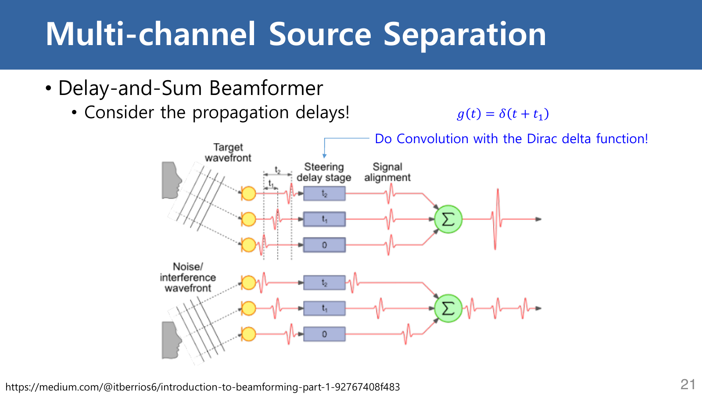

<a href="{{ "/assets/pdfs/study/speech-and-audio-recognition/speech-audio-lecture-08-1.pdf#page=21" | relative_url }}" target="_blank" rel="noopener">원문 PDF p. 21</a>의 위쪽은 목표 방향 신호다. 각 channel에 서로 다른 보상 지연을 적용하면 peak가 같은 위치로 정렬되고 합이 커진다. 아래쪽 간섭 방향은 같은 보상을 적용해도 정렬되지 않으므로 합이 상대적으로 작다.

시간영역 filter-and-sum은

$$
y(\theta,t)=\sum_{m=1}^{M}g_m(\theta,t)*x_m(t)
$$

이고, 주파수영역에서는

$$
Y(\theta,\omega)=\mathbf{w}(\theta,\omega)^{\mathsf H}\mathbf{x}(\omega)
$$

로 쓴다. $$\mathbf{x}$$는 $$M$$개 microphone의 복소 spectrum, $$\mathbf{w}$$는 spatial filter, $${\mathsf H}$$는 conjugate transpose다.

### 5.1 Steering vector와 conjugate가 헷갈리는 이유

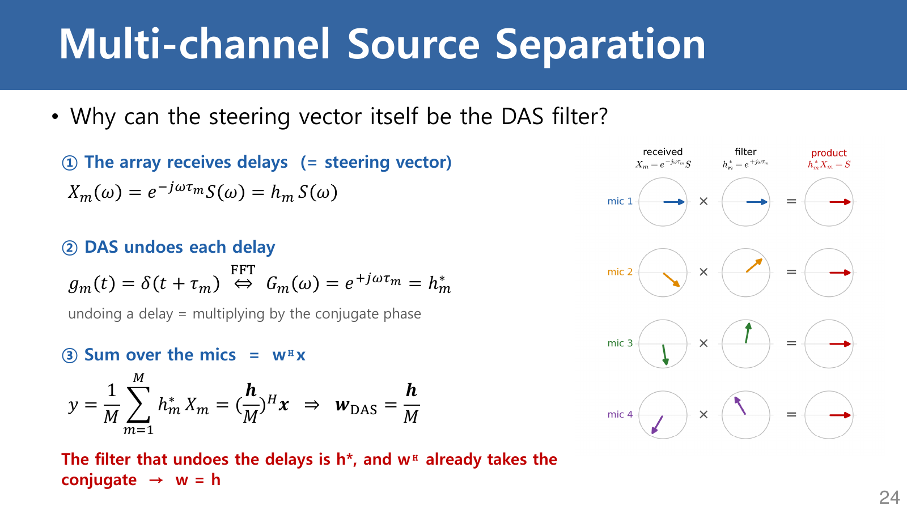

<a href="{{ "/assets/pdfs/study/speech-and-audio-recognition/speech-audio-lecture-08-1.pdf#page=24" | relative_url }}" target="_blank" rel="noopener">원문 PDF p. 24</a>에서 목표 source $$S(\omega)$$가 microphone $$m$$에 지연되어 도착한다고 하자.

$$
X_m(\omega)=e^{-j\omega\tau_m}S(\omega)
$$

이때 steering vector를

$$
\mathbf{h}(\theta,\omega)=
\begin{bmatrix}
e^{-j\omega\tau_1(\theta)}&\cdots&e^{-j\omega\tau_M(\theta)}
\end{bmatrix}^{\mathsf T}
$$

로 정의한다. DAS weight를 $$\mathbf{w}_{\mathrm{DAS}}=\mathbf{h}/M$$로 두면 실제 출력에서 $${\mathsf H}$$가 conjugate를 취한다.

$$
\mathbf{w}_{\mathrm{DAS}}^{\mathsf H}\mathbf{h}
=\frac{1}{M}\mathbf{h}^{\mathsf H}\mathbf{h}
=\frac{1}{M}\sum_{m=1}^{M}\lvert h_m\rvert^2=1
$$

따라서 가정한 방향과 실제 방향이 같으면 $$Y=S$$가 된다. **보상에 필요한 phase는 $$h_m^*$$지만 식을 $$\mathbf{w}^{\mathsf H}\mathbf{x}$$로 썼기 때문에 weight vector 자체에는 $$h_m$$을 넣는다.** Conjugate를 두 번 취하거나 생략하면 방향이 반대로 맞을 수 있다.

### 5.2 수치로 보는 phase 정렬

앞의 $$d=4$$ cm, $$\theta=30^\circ$$ 예제에서 1 kHz 성분의 인접 phase 차이는

$$
\Delta\phi=-2\pi(1000)(58.3\,\mu\mathrm{s})\approx-0.366\,\mathrm{rad}
$$

즉 약 $$-21.0^\circ$$다. 네 microphone의 phase는 약 $$[0,-21,-42,-63]^\circ$$로 벌어진다. DAS는 반대 phase를 곱해 모두 0°로 맞춘 뒤 평균한다. 반면 다른 방향에서 온 성분은 이 보상과 맞지 않아 residual phase가 남는다.

실시간 구현에서 $$\delta(t+\tau_m)$$는 미래 sample을 요구하는 advance라 그대로 causal하게 만들 수 없다. 공통 지연 $$\tau_{\max}$$을 추가해 각 channel을 $$\tau_{\max}-\tau_m$$만큼 **지연**시키면 상대 정렬은 같고 구현은 causal해진다.

Derivation: DAS normalization and distortionless response

목표 방향 $$\theta_0$$의 수신 vector가

$$
\mathbf{x}(\omega)=\mathbf{h}(\theta_0,\omega)S(\omega)
$$

라고 하자. 각 steering 성분은 pure delay이므로 $$\lvert h_m\rvert=1$$이다. $$\mathbf{w}=\mathbf{h}/M$$를 대입하면

$$
\begin{aligned}
Y(\omega)
&=\mathbf{w}^{\mathsf H}\mathbf{x}\\
&=\left(\frac{\mathbf{h}}{M}\right)^{\mathsf H}
\mathbf{h}S(\omega)\\
&=\frac{1}{M}\sum_{m=1}^{M}h_m^*h_mS(\omega)\\
&=S(\omega).
\end{aligned}
$$

$$1/M$$은 목표 방향에서 microphone 수만큼 amplitude가 커지는 것을 막아 unity gain을 만든다. Microphone gain mismatch, 위치 오차, near-field propagation, reverberation이 있으면 실제 steering vector가 가정과 달라져 $$\mathbf{w}^{\mathsf H}\mathbf{h}=1$$이 정확히 성립하지 않는다.

## 6. STFT domain에서 channel convolution을 다루는 이유

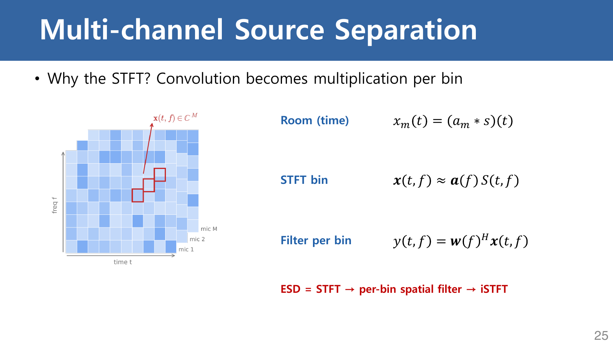

<a href="{{ "/assets/pdfs/study/speech-and-audio-recognition/speech-audio-lecture-08-1.pdf#page=25" | relative_url }}" target="_blank" rel="noopener">원문 PDF p. 25</a>은 시간영역의 room response를

$$
x_m(t)=(a_m*s)(t)
$$

로 쓰고, STFT에서는

$$
X_m(\ell,f)\approx A_m(f)S(\ell,f)
$$

로 단순화한다. $$\ell$$은 frame index, $$f$$는 frequency bin이다. 이 모델에서는 각 bin마다

$$
Y(\ell,f)=\mathbf{w}(f)^{\mathsf H}\mathbf{x}(\ell,f)
$$

를 계산한 뒤 iSTFT로 waveform을 복원한다.

여기서 `≈`가 중요하다. 긴 room impulse response가 여러 STFT frame에 걸치거나 filter의 spectrum이 한 bin 안에서 크게 변하면, 한 frame·한 bin의 단순 곱만으로는 정확하지 않다. 더 정확한 STFT model은 이웃 frame 또는 frequency 간 convolution을 포함한다. 또한 유한 길이 FFT의 단순 곱은 circular convolution을 만들므로, time-domain linear convolution을 구현할 때는 zero-padding과 overlap-add/overlap-save 같은 경계 처리가 필요하다.

Derivation: When convolution becomes a per-bin product

전체 Fourier transform에서는 convolution theorem이 정확하다.

$$
x_m(t)=a_m(t)*s(t)
\quad\Longleftrightarrow\quad
X_m(\omega)=A_m(\omega)S(\omega)
$$

STFT는 window $$v(t-\ell R)$$를 곱한 짧은 구간의 Fourier transform이다.

$$
X_m(\ell,\omega)=
\int x_m(t)v(t-\ell R)e^{-j\omega t}\,dt
$$

$$x_m=a_m*s$$를 대입하면 room response의 여러 지연 성분이 window 경계를 가로지를 수 있다. Room response가 window에 비해 충분히 짧고, frame 안에서 source와 transfer function이 거의 변하지 않으며, bin 안의 frequency variation이 작다고 보면

$$
X_m(\ell,f)\approx A_m(f)S(\ell,f)
$$

라는 narrowband multiplicative transfer function 근사를 얻는다. Reverberation이 길면 일반적으로

$$
X_m(\ell,f)\approx\sum_q A_m(q,f)S(\ell-q,f)
$$

처럼 frame 방향 convolution을 포함하는 convolutive transfer function이 더 적절하다. 따라서 per-bin beamforming은 유용한 계산 구조지만, 모든 room convolution을 무조건 정확히 한 번의 복소 곱으로 바꾸는 것은 아니다.

## 7. ESD에서 beamforming은 무엇을 하는가

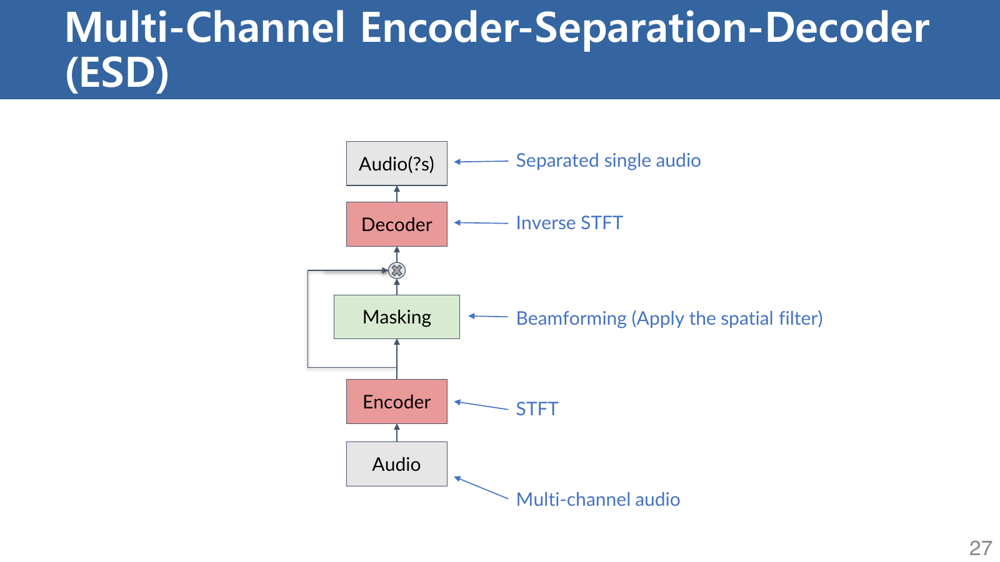

<a href="{{ "/assets/pdfs/study/speech-and-audio-recognition/speech-audio-lecture-08-1.pdf#page=27" | relative_url }}" target="_blank" rel="noopener">원문 PDF p. 27</a>의 block을 아래에서 위로 읽는다.

1. **Encoder:** 여러 channel의 waveform을 complex STFT로 바꾼다.
2. **Separation:** 각 frequency에서 spatial weight를 적용해 channel들을 하나의 target spectrum으로 결합한다.
3. **Decoder:** iSTFT로 time-domain signal을 복원한다.

그림은 separation block에 `Masking`이라고 적었지만, DAS 자체는 한 spectrogram에 element-wise mask를 곱하는 연산이 아니다. $$M$$개 channel을 복소 가중합하여 channel 축을 줄이는 spatial filtering이다. Deep multi-channel system에서는 network가 직접 mask를 예측해 spatial covariance를 추정하고 그 결과로 beamformer weight를 만들 수도 있지만, **ESD 구조라고 해서 separator가 항상 mask일 필요는 없다.**

## 8. Beam pattern: 주파수가 높을수록 좁아지는 이유

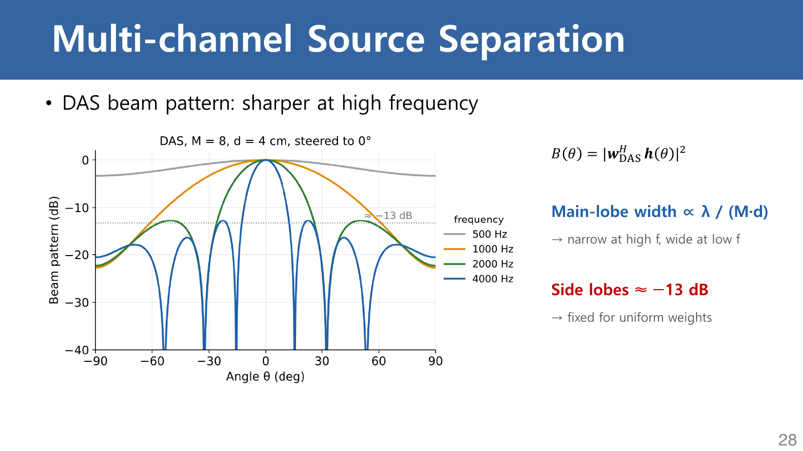

<a href="{{ "/assets/pdfs/study/speech-and-audio-recognition/speech-audio-lecture-08-1.pdf#page=28" | relative_url }}" target="_blank" rel="noopener">원문 PDF p. 28</a>의 가로축은 입사각, 세로축은 정규화한 power response(dB)다. 목표 방향은 0°다. 같은 물리적 aperture에서 주파수가 올라가면 파장 $$\lambda=c/f$$가 짧아지고, microphone 사이의 phase 차이가 더 빨리 변한다. 그래서 목표 방향에서 조금만 벗어나도 합이 상쇄되어 main lobe가 좁아진다.

$$
B(\theta)=\left\lvert\mathbf{w}_{\mathrm{DAS}}^{\mathsf H}
\mathbf{h}(\theta)\right\rvert^2
$$

Main-lobe width가 $$\lambda/(Md)$$에 비례한다는 표현은 array의 **electrical aperture**를 보여주는 근사다. 정확한 각도 폭은 microphone 수, 실제 aperture $$(M-1)d$$, steering angle, 폭을 재는 기준에 따라 달라진다. `sidelobe ≈ -13 dB`도 uniformly weighted ULA의 첫 sidelobe에 대한 대표값이다. Tapered weight를 쓰면 sidelobe를 줄일 수 있지만 main lobe가 넓어진다.

Derivation: ULA array factor and the main-lobe trade-off

Broadside $$\theta_0=0$$로 steer하고 microphone spacing을 $$d$$라 하자. Wavenumber는 $$k=2\pi/\lambda$$이며, angle $$\theta$$에서 인접 microphone의 phase 차이는

$$
\psi=kd\sin\theta
$$

다. Uniform DAS의 normalized array factor는 geometric series로

$$
A(\theta)=\frac{1}{M}\sum_{m=0}^{M-1}e^{-jm\psi}
=\frac{1}{M}e^{-j(M-1)\psi/2}
\frac{\sin(M\psi/2)}{\sin(\psi/2)}
$$

가 된다. Power pattern은 $$B(\theta)=\lvert A(\theta)\rvert^2$$다. 첫 null은 대략 $$M\psi/2=\pm\pi$$에서 생기므로 작은 각도에서는

$$
\lvert\theta_{\mathrm{null}}\rvert
\approx\frac{\lambda}{Md}
$$

다. 주파수 $$f$$가 커지면 $$\lambda=c/f$$가 작아져 main lobe가 좁아진다. 동시에 spacing이 파장에 비해 너무 커지면 다른 각도에서도 phase가 다시 맞아 grating lobe가 생긴다.

## 9. Spatial aliasing과 $$d\le\lambda/2$$ 조건

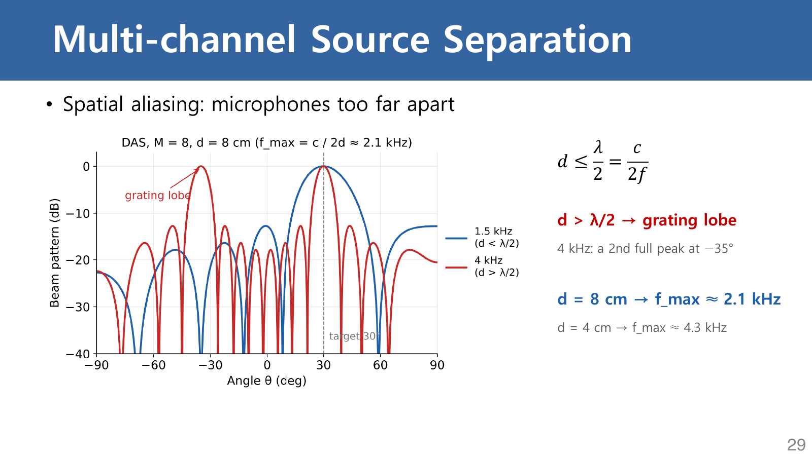

<a href="{{ "/assets/pdfs/study/speech-and-audio-recognition/speech-audio-lecture-08-1.pdf#page=29" | relative_url }}" target="_blank" rel="noopener">원문 PDF p. 29</a>에서 target은 30°다. 1.5 kHz에는 목표 방향의 주 peak만 보이지만, 4 kHz에는 약 -35°에서 같은 높이의 peak가 생긴다. Array가 두 방향의 phase pattern을 구별하지 못하는 **grating lobe**다.

좁은 대역 ULA에서 개방 가시영역의 grating lobe를 막는 통상 조건은

$$
d\le\frac{\lambda}{2}=\frac{c}{2f}
$$

이다. 폐구간 $$[-90^\circ,90^\circ]$$ 전체에서 방향을 엄밀히 유일하게 구별하려면 $$d<\lambda/2$$가 필요하다. 경계 $$d=\lambda/2$$에서는 양쪽 endfire가 같은 spatial sample을 만드는 특수한 모호성이 있고 위치·음속 오차의 여유도 없으므로, 실제 설계에서는 최고 사용 주파수에서 더 작은 spacing을 택하기도 한다.

- $$d=0.08$$ m이면 $$f_{\max}=343/(2\times0.08)\approx2.14$$ kHz다.
- $$d=0.04$$ m이면 $$f_{\max}=343/(2\times0.04)\approx4.29$$ kHz다.
- 4 kHz의 파장은 약 8.58 cm이므로 8 cm spacing은 $$\lambda/2$$보다 크다.

Target 30°에서 grating lobe는

$$
\sin\theta_g=\sin30^\circ-\frac{\lambda}{d}
$$

를 만족하는 branch에서 생긴다. $$\lambda/d\approx1.072$$를 넣으면 $$\sin\theta_g\approx-0.572$$, 즉 $$\theta_g\approx-34.9^\circ$$다. 원문 그래프의 -35°와 맞는다.

이 조건은 원문의 **주파수별 narrowband beam pattern**을 읽는 기준이다. Broadband speech의 전체 spatial aliasing은 signal의 시간 변화와 frequency 간 관계까지 포함하므로, 한 개 주파수의 $$d\le\lambda/2$$만으로 전체 성능을 모두 설명할 수는 없다.

Derivation: Why a second full peak appears

Steering angle을 $$\theta_0$$라 하면 microphone $$m$$에서 보상 후 남는 phase increment는

$$
\Delta\phi(\theta)
=\frac{2\pi d}{\lambda}
\left(\sin\theta-\sin\theta_0\right)
$$

다. 목표 방향에서는 0이다. 다른 방향에서도 모든 microphone phase가 다시 같아지려면 이 increment가 $$2\pi q$$, $$q\in\mathbb Z$$가 되어야 한다.

$$
\frac{2\pi d}{\lambda}
\left(\sin\theta_g-\sin\theta_0\right)=2\pi q
$$

따라서

$$
\sin\theta_g=\sin\theta_0+q\frac{\lambda}{d}
$$

이다. 오른쪽이 $$[-1,1]$$ 안에 들어오는 $$q\ne0$$가 있으면 가시 영역에 grating lobe가 존재한다. $$d\le\lambda/2$$는 개방 가시영역에서 이런 정수 branch가 들어오는 것을 막는 통상 조건이고, 양쪽 endfire까지 포함한 폐구간의 엄밀한 유일성에는 $$d<\lambda/2$$가 필요하다. 특정 steering 범위만 사용하면 설계 조건을 별도로 계산할 수 있다.

## 마지막 핵심 정리

| 개념 | 기억할 관계 | 적용 조건 또는 주의점 |
|---|---|---|
| TDOA | $$\tau_m=(m-1)d\sin\theta/c$$ | Far-field plane wave, 알려진 geometry와 각도 convention |
| Filter | $$y[n]=\sum_k h[k]x[n-k]$$ | Scalar gain과 달리 frequency별 magnitude·phase를 바꾼다. |
| Dirac delta | $$f*\delta(\cdot-t_0)=f(\cdot-t_0)$$ | `0에서 ∞인 보통 함수`가 아니라 distribution이다. |
| DAS | $$\mathbf{w}=\mathbf{h}/M$$, $$Y=\mathbf{w}^{\mathsf H}\mathbf{x}$$ | $${\mathsf H}$$가 conjugate를 취한다. Causal 구현은 공통 지연을 더한다. |
| STFT spatial filter | $$Y(\ell,f)=\mathbf{w}(f)^{\mathsf H}\mathbf{x}(\ell,f)$$ | Per-bin 곱은 narrowband 근사이며 iSTFT 조건과 경계 처리가 필요하다. |
| Beam width | 대략 $$\lambda/(Md)$$에 비례 | 높은 주파수에서 좁아지지만 spatial aliasing 위험은 커진다. |
| Spatial aliasing | 통상 $$d\le c/(2f_{\max})$$ | Narrowband ULA 기준. 등호에서는 양쪽 endfire 모호성이 남고, broadband 전체 성능의 충분조건은 아니다. |

## Study Guide

1. p. 8에서 geometry를 보고 $$d\sin\theta$$가 거리, 이를 $$c$$로 나눈 값이 시간이라는 단위 관계를 먼저 확인한다.
2. pp. 12–17에서 scalar, FIR filter, impulse response, convolution의 차이를 연결한다.
3. pp. 21–24에서 `received phase`, `compensating phase`, $$\mathbf{w}^{\mathsf H}$$의 conjugate를 한 줄씩 추적한다.
4. pp. 25–27에서 STFT가 channel별 복소 spectrum을 만들고 beamformer가 channel 축을 결합한다는 점을 확인한다.
5. pp. 28–29에서 높은 주파수가 resolution을 높이는 효과와 grating lobe를 만드는 위험을 함께 비교한다.

## 복습 질문

1. 같은 소리를 여러 microphone이 다르게 기록하는 가장 기본적인 이유는 무엇인가?

답변: Source에서 각 microphone까지의 경로 길이가 다르기 때문이다. 경로 차이는 시간 지연이 되고, 주파수영역에서는 주파수에 비례하는 phase 차이로 나타난다. 거리·지향성·반사 환경에 따라 크기 차이도 생길 수 있다.

2. 단순히 모든 channel을 더하는 것과 DAS의 차이는 무엇인가?

답변: 단순 합은 특정 방향의 시간차를 보상하지 않는다. DAS는 목표 방향의 channel별 지연을 먼저 맞춘 뒤 평균한다. 목표 방향 성분은 coherent하게 더해지고, 다른 방향 성분은 residual phase 때문에 덜 더해진다.

3. 왜 $$\mathbf{w}=\mathbf{h}/M$$인데 실제 보상 phase는 $$h_m^*$$인가?

답변: 출력 식이 $$\mathbf{w}^{\mathsf H}\mathbf{x}$$이기 때문이다. Hermitian transpose가 $$\mathbf{w}$$의 각 성분에 conjugate를 취하므로, vector에는 $$h_m$$을 넣어도 실제 곱은 $$h_m^*X_m$$이 된다.

4. STFT를 쓰면 time-domain convolution이 항상 정확히 bin별 곱으로 바뀌는가?

답변: 전체 Fourier transform의 convolution theorem은 정확하지만, windowed STFT에서 한 frame·한 bin의 곱은 narrowband 근사다. Room response가 길거나 frame 경계를 많이 넘으면 frame 방향 convolution이나 더 일반적인 cross-band model이 필요하다.

5. 8 cm 간격 array가 4 kHz에서 aliasing을 만드는 이유는 무엇인가?

답변: 4 kHz의 파장은 약 8.58 cm이고 반파장은 약 4.29 cm다. 8 cm는 반파장보다 커서 서로 다른 두 방향이 microphone마다 같은 modulo-$$2\pi$$ phase pattern을 만들 수 있다. 원문 설정에서는 목표 30° 외에 약 -35°의 full grating lobe가 생긴다.

6. ESD의 Separation block은 항상 element-wise mask인가?

답변: 아니다. 이 강의의 multi-channel ESD에서는 복소 spatial weight로 여러 channel을 합치는 beamforming이 핵심이다. Deep model이 mask를 예측해 weight 계산을 도울 수는 있지만, ESD라는 구조만으로 mask 연산이 필수라고 결론낼 수 없다.

## PDF

<ul>
  <li><a href="{{ "/assets/pdfs/study/speech-and-audio-recognition/speech-audio-lecture-08-1.pdf" | relative_url }}" target="_blank" rel="noopener">SpeechAudio Lecture 8-1: Multi-channel Source Separation 1-1</a></li>
</ul>

## References

- <a href="https://github.com/yandexdataschool/speech_course" target="_blank" rel="noopener">Yandex Data School Speech Course</a>
- <a href="https://github.com/markovka17/dla" target="_blank" rel="noopener">DLA Course Materials</a>
- <a href="https://docs.scipy.org/doc/scipy/reference/generated/scipy.signal.ShortTimeFFT.html" target="_blank" rel="noopener">SciPy ShortTimeFFT Documentation</a>
- <a href="https://arxiv.org/abs/1711.07911" target="_blank" rel="noopener">Multichannel Speech Separation and Enhancement Using the Convolutive Transfer Function</a>
- <a href="https://ieeexplore.ieee.org/document/4696048/" target="_blank" rel="noopener">On Spatial Aliasing in Microphone Arrays</a>
- <a href="https://medium.com/@itberrios6/introduction-to-beamforming-part-1-92767408f483" target="_blank" rel="noopener">Introduction to Beamforming, Part 1</a> — 원문 pp. 10–11, 20–21의 도식 출처
